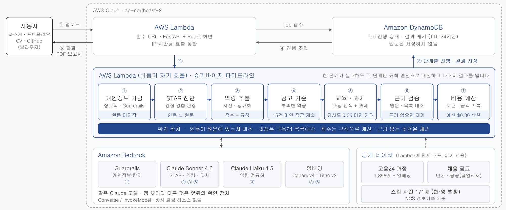

# 역량다리 (SkillBridge)

**같은 Claude라도, 앞뒤에 확인 장치를 붙인 시스템으로 돌리면 기관이 믿고 쓸 수 있는 답이 됩니다.**

자기소개서·포트폴리오·CV·GitHub를 올리면 **STAR 강점 진단 → 실제 채용 공고 기준 부족 역량 → 고용24 교육과정과 과제**를, 모든 판정에 원문 근거를 붙여 보여 줍니다. 근거가 없으면 추천하지 않습니다.

- **서비스**: https://fazwtcf7omav34gdiahcgvds3m0zyafv.lambda-url.ap-northeast-2.on.aws/ (시연용 합성 자소서: [demo_resume.md](docs/pivot/captures/demo_resume.md))
- 주제: **AWS 클라우드 기반 채용시장 기술역량 자동 분석 및 교육과정 추천 AI 에이전트 개발**
- KOSA × AWS AI 부트캠프 해커톤 06팀 · 변유민(팀장) · 김채희 · 김승제 · 이승연

## 결과

같은 Claude Sonnet 4.6, 사람이 검토한 정답 60단락 × 5회. 시험 단락은 미리 떼어 두고 한 번만 채점했습니다. [전체 보고서](eval/trust/report.md)

| | **역량다리** | 웹 Claude (그냥 묻기) | 웹 Claude (우리 기준까지 준 프롬프트) |
|---|---|---|---|
| STAR 칸이 정답과 일치 | **96%** | 81% | 95% (차이 유의하지 않음) |
| 없는 근거를 '있다'고 한 비율 ↓ | **2%** | 36% | 7% |
| 5번 넣어 모두 같은 판정 | **100%** | 62% | 88% |

판정 정확도는 프롬프트로 따라올 수 있지만, **없는 근거를 걸러 내고 매번 같은 답을 내는 것은 시스템**에서 나옵니다.

## 구조



- Claude가 고른 인용이 **원문에 정말 있는지 코드로 대조**하고, 교육과정은 **고용24 목록에 있는 것만**, 점수는 **규칙으로만** 계산합니다.
- Amazon Bedrock(Claude Sonnet 4.6 · Haiku 4.5 · Guardrails · Cohere Embed v4) · AWS Lambda(비동기) · DynamoDB. 상시 과금 리소스가 없습니다.
- 분석 1건 약 $0.03~0.18. 이력서 원문은 저장하지 않습니다(결과만 24시간 캐시).

## 사람이 확인한 것

- 사람 평가자 둘의 STAR 판정 일치 89%(κ 0.78) — [disagreements_ab.md](eval/trust/disagreements_ab.md)
- 교육 검색: 키워드 대비 nDCG@5 0.65 → 0.82(유의), 사람 재판정과 일치 77% — [report_retrieval.md](eval/trust/report_retrieval.md)
- 추천 과제 16개 사람 판정: 부적절 0 · 적절 11 · 애매 5 — [task_judge_result.json](eval/trust/task_judge_result.json)
- 취준생 29명 설문: 모르는 기술은 생성형 AI로 확인 86% — [survey_needs.md](eval/survey_needs.md)

## 한계

- 평가 단락은 **합성**이라 실제 자소서에서는 숫자가 낮을 수 있습니다.
- 민간 공고는 직군별 22~45건입니다(화면에 건수 표시, 15건 미만 직군 제외).
- 합격 여부는 예측하지 않으며, 채용 합불 판단에 쓰지 않습니다.

## 실행

```powershell
.\tasks.ps1 setup    # .venv · npm install · .env 생성
.\tasks.ps1 run      # API :8010 + 웹 :5173 (BEDROCK_MOCK=1이면 AWS 없이 규칙으로 동작)
.\tasks.ps1 test     # pytest
```

## 더 보기

| 문서 | 내용 |
|---|---|
| [docs/DEMO_SCRIPT.md](docs/DEMO_SCRIPT.md) | 발표 대본과 예상 질문 |
| [eval/trust/](eval/trust/) | 정답셋, 웹 비교, 검색 실험, 보고서 |
| [DECISIONS.md](DECISIONS.md) | 설계 결정과 이유 |
| [docs/README_v1_이전주제.md](docs/README_v1_이전주제.md) | 11-17 멘토링 전 주제(기업 실무 기준) |
